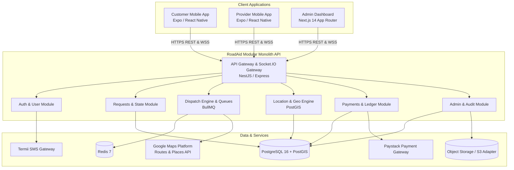

# ROADAID — SYSTEM ARCHITECTURE & DESIGN RECORDS

## 1. High-Level Architecture

## 2. Core Architectural Decision Records (ADRs)

### ADR-001: Modular Monolith vs Microservices
- **Decision:** Build a single NestJS modular monolith with BullMQ workers in-process for MVP.
- **Rationale:** Minimizes operational complexity and deployment friction under the tight deadline while maintaining clean domain boundaries (modules, interfaces, contracts) that can be factored into standalone services later if necessary.

### ADR-002: Concurrency & Invariants Protection
- **Decision:** Combine PostgreSQL PostGIS spatial indexes, `SELECT ... FOR UPDATE SKIP LOCKED`, and partial unique database indexes (`uq_provider_one_active_request`, `uq_request_one_pending_offer`, `uq_provider_one_pending_offer`).
- **Rationale:** Ensures that even with multiple concurrent API requests or distributed workers, double dispatch and provider collisions are prevented at the database storage engine level.

### ADR-003: Double-Entry Immutable Ledger
- **Decision:** Financial balances are derived as `SUM(amount_kobo)` over immutable `ledger_entries`. `wallet_balance_kobo` in `provider_profiles` is an audited cache.
- **Rationale:** Eliminates silent financial mutations, provides an indelible audit trail, and simplifies reconciliation with gateway payouts.
